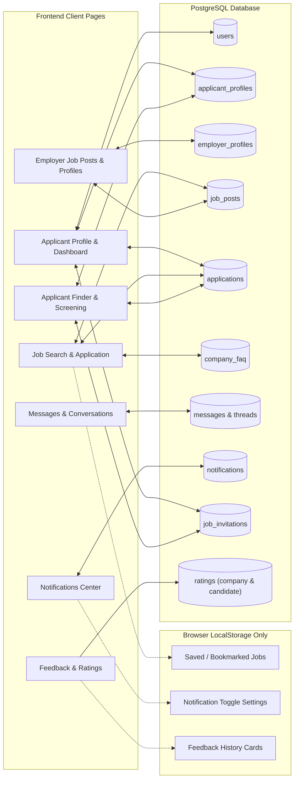

# EliteCruit System Data Audit & Inventory Report
**Date Generated:** September 30, 2026  
**Scope:** Full application scan across all user-facing pages (Applicant, Employer, and Shared/Common modules; excluding Admin portal) mapped directly against PostgreSQL database tables, endpoints, and client storage.

---

## 1. System Architecture & Data Flow



---

## 2. Page-by-Page Data Sync (Fetched In & Out of Database)

### 2.1 Auth Module (`Login.tsx`, `Create-Account.tsx`)
- **Endpoints:**
  - `POST /api/auth/register`
  - `POST /api/auth/login`
- **Tables:** `users`, `applicant_profiles`, `employer_profiles`
- **Data In & Out:**
  - `email`, `password_hash`, `role` ('applicant', 'employer', 'admin'), `is_active`
  - `first_name`, `last_name` (Applicant)
  - `business_name` (Employer)
  - `terms_accepted: true`, `terms_accepted_at: CURRENT_TIMESTAMP`

---

### 2.2 Applicant Profile (`ApplicantProfile.tsx`)
- **Endpoints:**
  - `GET /api/applicants/:id/profile`
  - `PUT /api/applicants/:id/profile`
  - `PUT /api/applicants/:id/tags`
  - `PUT /api/applicants/:id/location`
  - `PUT /api/applicants/:id/work-experience`
  - `POST /api/applicants/:id/resume`
  - `GET /api/applicants/:id/resume`
  - `DELETE /api/applicants/:id/resume`
- **Tables:** `applicant_profiles`, `users`
- **Data In & Out:**
  - **Identity & Contact:** `first_name`, `middle_name`, `last_name`, `email`, `phone`
  - **Geographic Location:** `province`, `city`, `address`, `nearby_location`, `latitude`, `longitude`
  - **Career Preferences:** `desired_job_title`, `work_arrangement`, `expected_salary_min`, `expected_salary_max`
  - **Competencies & Qualifications:** `skills`, `certifications` (with acquired and expiry years), `qualifications`, `summary`, `languages`, `preferred_locations`, `preferred_cities_json`
  - **Timeline:** `work_experience_json` (multi-job history including titles, companies, dates, responsibilities, skills)
  - **Document Storage:** `resume_path`, `resume_data` (binary BLOB/bytea), `resume_mimetype`

---

### 2.3 Applicant Dashboard (`Applicant-Dashboard.tsx`)
- **Endpoints:**
  - `GET /api/job-posts`
  - `GET /api/applicants/:id/profile`
  - `GET /api/applicants/:id/applications`
  - `GET /api/applicants/:id/job-invitations`
  - `PATCH /api/applicants/:id/job-invitations/:invId`
  - `POST /api/applicants/:id/applications`
  - `GET /api/employers/:id/faqs`
- **Tables:** `job_posts`, `applications`, `job_invitations`, `company_faq`, `company_ratings`
- **Data In & Out:**
  - **In:** Open job posts list, application status tracker (`submitted`, `under_review`, `shortlisted`, `accepted`, `rejected`), received direct job invitations, company FAQs, employer rating score.
  - **Out:** Accepting or declining recruitment invitations (`status: 'accepted' | 'declined'`), submitting new applications.

---

### 2.4 Job Search & Exploration (`JobSearch.tsx`)
- **Endpoints:**
  - `GET /api/job-posts`
  - `POST /api/applicants/:id/applications`
  - `GET /api/employers/:id/faqs`
  - `GET /api/applicants/:id/applications`
- **Tables:** `job_posts`, `applications`, `company_faq`, `employer_profiles`
- **Data In & Out:**
  - **In:** Job title, company name, location, branch name, branch address, salary minimum/maximum, setup arrangement, experience level, qualifications, certifications, required skills, close date, urgent flag, applicant count, employer FAQ list.
  - **Out:** Submitting job applications (`job_post_id`, `applicant_user_id`, `status: submitted`).
  - **Client-Side Only:** Bookmarked/saved jobs stored in browser `localStorage`.

---

### 2.5 Employer Dashboard (`Employer-Dashboard.tsx`)
- **Endpoints:**
  - `GET /api/employers/:id/dashboard-summary`
- **Tables:** `job_posts`, `applications`, `users`
- **Data In & Out:**
  - **In:** Count of active jobs, total applications count, shortlisted candidate count, pending to-review count, active job posts list, recent applications list.

---

### 2.6 Employer Job Posts (`Employer-JobPosts.tsx`, `Employer-JobPostsList.tsx`)
- **Endpoints:**
  - `POST /api/employers/:id/job-posts`
  - `PUT /api/employers/:id/job-posts/:id`
  - `GET /api/employers/:id/job-posts`
  - `GET /api/employers/:id/job-posts/:id`
- **Tables:** `job_posts`, `employer_profiles`
- **Data In & Out:**
  - **In & Out:** `title`, `location`, `branch_name`, `branch_address`, `work_arrangement`, `experience_level`, `is_urgent`, `salary_min`, `salary_max`, `description`, `qualifications`, `certifications`, `required_skills`, `close_date`, `accepts_non_graduates`, `education_requirements`.
  - **Deprecated:** `application_limit` is set to NULL on the backend per the no-limit policy.

---

### 2.7 Employer Applicant Management & Screening (`Employer-ApplicantManagement.tsx`)
- **Endpoints:**
  - `GET /api/employers/:id/applications`
  - `PATCH /api/applications/:id/status`
  - `PUT /api/applications/bulk-status`
  - `POST /api/employers/:id/invite-candidate`
  - `GET /api/applicants/:id/resume`
  - `GET /api/employers/:id/job-invitations`
- **Tables:** `applications`, `applicant_profiles`, `job_posts`, `job_invitations`, `candidate_ratings`
- **Data In & Out:**
  - **In:** Candidate profile data, application stage status, resume document view/stream, job requirements, candidate ratings.
  - **Out:** Drag-and-drop or button stage transitions (`submitted` -> `under_review` -> `shortlisted` -> `approved`/`accepted` / `denied`/`rejected`), sending direct invitations.

---

### 2.8 Employer Applicant Finder (`Employer-ApplicantFinder.tsx`)
- **Endpoints:**
  - `GET /api/employers/:id/talent-pool`
  - `GET /api/employers/:id/active-job-posts`
  - `POST /api/employers/:id/invite-candidate`
- **Tables:** `users`, `applicant_profiles`, `job_posts`, `job_invitations`, `candidate_ratings`
- **Data In & Out:**
  - **In:** Full talent pool applicant records, geo-coordinates (`latitude`, `longitude`, `city`), desired job titles, competencies, resumes, active jobs for the invitation carousel.
  - **Out:** Sending direct invitations (`applicant_user_id`, `job_post_id`, `custom_message`).

---

### 2.9 Employer Company Profile (`Employer-CompanyProfile.tsx`)
- **Endpoints:**
  - `GET /api/employers/:id/profile`
  - `PUT /api/employers/:id/profile`
- **Tables:** `employer_profiles`, `users`
- **Data In & Out:**
  - **In & Out:** `business_name`, `business_email`, `contact_number`, `industry`, `company_size`, `company_description`, `province`, `city`, `company_address`, `branches_json`.
  - **Dropped from DB:** `website` was permanently removed from database schema.

---

### 2.10 Employer FAQ Management (`Employer-FaqManagement.tsx`)
- **Endpoints:**
  - `GET /api/employers/:id/faqs`
  - `POST /api/employers/:id/faqs`
  - `PUT /api/employers/:id/faqs/:id`
  - `DELETE /api/employers/:id/faqs/:id`
- **Tables:** `company_faq`
- **Data In & Out:**
  - **In & Out:** `question`, `answer`, `question_type`, `is_active` (toggle visibility).

---

### 2.11 Communication Modules (`Messages.tsx`, `Notifications.tsx`)
- **Endpoints:**
  - `GET /api/users/:id/threads`
  - `GET /api/threads/:id/messages`
  - `POST /api/threads/:id/messages`
  - `GET /api/users/:id/notifications`
  - `PATCH /api/notifications/:id/read`
  - `PATCH /api/notifications/mark-all-read`
  - `DELETE /api/users/:id/notifications`
- **Tables:** `message_threads`, `message_participants`, `messages`, `notifications`
- **Data In & Out:**
  - Thread metadata, conversation messages, sender IDs, timestamps, notification titles/bodies, read flags (`is_read`).

---

### 2.12 Feedback Module (`Applicant-Feedback.tsx`)
- **Endpoints:**
  - `POST /api/applicants/:id/company-feedback`
  - `POST /api/employers/:id/applicant-feedback`
- **Tables:** `company_ratings`, `candidate_ratings`
- **Data In & Out:**
  - **Out:** Rating star score (1-5), feedback comments, target user ID.
  - **In:** Averages (`AVG(rating)`) are pulled across job postings and talent cards.
  - **Client-Side Storage:** History cards displayed on this page are stored in `localStorage`.

---

## 3. Database Table Inventory & Column Usage Status

### 1. `users`
| Column | Type | Status | Usage Notes |
| :--- | :--- | :--- | :--- |
| `id` | INTEGER PK | **Active** | Primary user identifier across all relations. |
| `email` | TEXT UNIQUE | **Active** | Authentication and contact display. |
| `password_hash` | TEXT | **Active** | Bcrypt hashed credentials. |
| `role` | TEXT | **Active** | Access control: `'applicant'`, `'employer'`, `'admin'`. |
| `is_active` | BOOLEAN | **Partial** | Enforced at login; modified only by admin. |
| `created_at` | TIMESTAMPTZ | **Active** | Account registration timestamp. |

---

### 2. `applicant_profiles`
| Column | Type | Status | Usage Notes |
| :--- | :--- | :--- | :--- |
| `user_id` | INTEGER PK FK | **Active** | Links to `users.id`. |
| `first_name`, `middle_name`, `last_name` | TEXT | **Active** | Candidate name representation. |
| `terms_accepted`, `terms_accepted_at` | BOOLEAN / TIMESTAMPTZ | **Standby** | Stored at registration; not shown in UI. |
| `phone` | TEXT | **Active** | Contact number. |
| `province`, `city`, `address` | TEXT | **Active** | Candidate residence location. |
| `desired_job_title` | TEXT | **Active** | Target position for match engine. |
| `expected_salary` | TEXT | **Legacy** | Replaced by numeric min/max columns. |
| `expected_salary_min`, `expected_salary_max` | NUMERIC | **Active** | Primary numeric salary range. |
| `work_arrangement` | TEXT | **Active** | On-Site, Hybrid, or Remote preference. |
| `skills`, `certifications`, `qualifications` | TEXT | **Active** | Core competency lists with year metadata. |
| `summary`, `languages` | TEXT | **Active** | Bio and spoken languages. |
| `preferred_locations`, `preferred_cities_json` | TEXT | **Active** | Target work areas. |
| `work_experience_json` | TEXT | **Active** | JSON array of timeline employment records. |
| `resume_path`, `resume_data`, `resume_mimetype`| TEXT / BLOB | **Active** | Stored binary document and file metadata. |
| `latitude`, `longitude` | NUMERIC | **Active** | Applicant pinpoint map coordinates. |
| `nearby_location` | TEXT | **Active** | Active toggle string for nearby discovery. |
| `profile_picture_path` | TEXT | **Dormant in DB** | Column exists in DB, but no UI upload exists. |
| `shs_strand`, `shs_school`, `shs_grad_year` | TEXT | **Standby** | Filterable in Finder, but no profile form input. |
| `college_grad_year`, `vocational_grad_year` | TEXT | **Standby** | Returned in talent queries, but no profile form input. |
| `is_non_graduate_cert_holder` | INTEGER | **Standby** | Queried in talent pool, but no profile form toggle. |
| `years_of_experience` | TEXT | **Legacy** | Column exists, but experience limits were removed. |

---

### 3. `employer_profiles`
| Column | Type | Status | Usage Notes |
| :--- | :--- | :--- | :--- |
| `user_id` | INTEGER PK FK | **Active** | Links to `users.id`. |
| `business_name` | TEXT | **Active** | Company legal/trade name. |
| `terms_accepted`, `terms_accepted_at` | BOOLEAN / TIMESTAMPTZ | **Standby** | Stored at registration; not shown in UI. |
| `industry` | TEXT | **Active** | Sector classification. |
| `company_size` | TEXT | **Active** | Employee headcount bracket. |
| `company_description` | TEXT | **Active** | Organization overview. |
| `contact_number` | TEXT | **Active** | Primary recruiter contact. |
| `province`, `city` | TEXT | **Active** | Headquarters province and city dropdowns. |
| `company_address` | TEXT | **Active** | Legacy/branch address compatibility. |
| `branches_json` | TEXT | **Active** | JSON array of secondary branch offices. |
| `company_logo_path`, `company_cover_path` | TEXT | **Dormant in DB** | Buttons in UI lack upload backend handler. |
| `website` | TEXT | **Deleted** | Dropped from database per request. |

---

### 4. `job_posts`
| Column | Type | Status | Usage Notes |
| :--- | :--- | :--- | :--- |
| `id` | INTEGER PK | **Active** | Job posting identifier. |
| `employer_user_id` | INTEGER FK | **Active** | Posting company account. |
| `title`, `location` | TEXT | **Active** | Position title and office location. |
| `branch_name`, `branch_address` | TEXT | **Active** | Office branch association. |
| `status` | TEXT | **Active** | `'open'` or `'closed'` (derived from close date). |
| `is_urgent` | INTEGER | **Active** | Urgent hiring flag (0/1). |
| `work_arrangement` | TEXT | **Active** | On-Site, Hybrid, Remote. |
| `experience_level` | TEXT | **Active** | Fresh Grad, Junior, Mid, Senior. |
| `salary_min`, `salary_max` | INTEGER | **Active** | Compensation boundary numbers. |
| `description` | TEXT | **Active** | Full job summary. |
| `qualifications`, `certifications`, `required_skills` | TEXT | **Active** | Candidate requirement tags. |
| `accepts_non_graduates` | INTEGER | **Active** | Non-degree qualification flag. |
| `education_requirements` | TEXT | **Active** | Education criteria note. |
| `close_date` | TEXT | **Active** | Auto-close cutoff date (MM/DD/YYYY). |
| `application_limit` | INTEGER | **Deprecated** | Column exists, but forced to NULL (no limits). |
| `responsibilities` | TEXT | **Deleted** | Dropped from database. |
| `created_at`, `updated_at` | TIMESTAMPTZ | **Active** | Audit timestamps. |

---

### 5. `applications`
| Column | Type | Status | Usage Notes |
| :--- | :--- | :--- | :--- |
| `id` | INTEGER PK | **Active** | Application entry ID. |
| `job_post_id` | INTEGER FK | **Active** | Target position. |
| `applicant_user_id` | INTEGER FK | **Active** | Candidate applicant account. |
| `status` | TEXT | **Active** | `'submitted'`, `'under_review'`, `'shortlisted'`, `'accepted'`, `'rejected'`. |
| `submitted_at`, `updated_at` | TIMESTAMPTZ | **Active** | Application lifecycle timestamps. |

---

### 6. `company_faq`
| Column | Type | Status | Usage Notes |
| :--- | :--- | :--- | :--- |
| `id` | INTEGER PK | **Active** | FAQ item ID. |
| `employer_user_id` | INTEGER FK | **Active** | Owning employer account. |
| `question`, `answer` | TEXT | **Active** | FAQ Q&A content. |
| `question_type` | TEXT | **Active** | Category (Requirements, Benefits, etc.). |
| `is_active` | INTEGER | **Active** | Visibility toggle (1 = visible, 0 = hidden). |
| `created_at`, `updated_at` | TIMESTAMPTZ | **Active** | Timestamps. |

---

### 7, 8, 9. Messaging Tables (`message_threads`, `message_participants`, `messages`)
| Table | Key Columns | Status | Usage Notes |
| :--- | :--- | :--- | :--- |
| `message_threads` | `id`, `created_by_user_id`, `title`, `created_at`, `updated_at` | **Active** | Conversation container. |
| `message_participants` | `thread_id`, `user_id`, `last_read_at` | **Active** | Multi-user conversation mapping. |
| `messages` | `id`, `thread_id`, `sender_user_id`, `message_text`, `created_at` | **Active** | Individual message logs. |

---

### 10. `notifications`
| Column | Type | Status | Usage Notes |
| :--- | :--- | :--- | :--- |
| `id` | INTEGER PK | **Active** | Notification ID. |
| `user_id` | INTEGER FK | **Active** | Recipient account. |
| `type` | TEXT | **Active** | `'new_application'`, `'application_status'`, `'job_invitation'`. |
| `title`, `body` | TEXT | **Active** | Displayed text. |
| `is_read` | INTEGER | **Active** | Read status flag (0 or 1). |
| `related_user_id`, `related_application_id` | INTEGER | **Active** | Entity links for navigation. |
| `created_at` | TIMESTAMPTZ | **Active** | Notification timestamp. |
| `read_at` | TIMESTAMPTZ | **Standby** | Remains NULL in current update query. |

---

### 11 & 12. Rating Tables (`company_ratings`, `candidate_ratings`)
| Table | Columns | Status | Usage Notes |
| :--- | :--- | :--- | :--- |
| `company_ratings` | `employer_user_id`, `applicant_user_id`, `rating` (1-5), `comments` | **Active** (Averages & Write) | Rated by applicants; aggregated for company score. |
| `candidate_ratings` | `employer_user_id`, `applicant_user_id`, `rating` (1-5), `comments` | **Active** (Averages & Write) | Rated by employers; aggregated for talent score. |

---

### 13. `job_invitations`
| Column | Type | Status | Usage Notes |
| :--- | :--- | :--- | :--- |
| `id` | INTEGER PK | **Active** | Invitation identifier. |
| `employer_user_id`, `applicant_user_id` | INTEGER FK | **Active** | Employer sender and applicant receiver. |
| `job_post_id` | INTEGER FK | **Active** | Position being offered. |
| `status` | TEXT | **Active** | `'pending'`, `'accepted'`, `'declined'`. |
| `custom_message` | TEXT | **Active** | Personalized note from recruiter. |
| `created_at`, `updated_at` | TIMESTAMPTZ | **Active** | Lifecycle timestamps. |

---

## 4. Client-Side Only Data (Stored in `localStorage`, Not in Database)

| Feature | LocalStorage Key | Description / Impact |
| :--- | :--- | :--- |
| **Saved / Bookmarked Jobs** | `elitecruit-bookmarked-jobs` | Saved job IDs on `JobSearch.tsx`. Not saved to DB; lost if browser cache is cleared. |
| **Notification Settings** | `elitecruit-notif-settings` | Toggle states in `Notifications.tsx` (Email, Application updates, etc.). |
| **Feedback History Cards** | `elitecruit-applicant-feedback-history`<br>`elitecruit-employer-feedback-history` | The rendered list of past reviews in `Applicant-Feedback.tsx`. (Ratings do write to DB tables, but the visual history feed is loaded from local storage). |

---

## 5. Schema Gaps (Frontend Sends Data, but Backend Drops/Ignores It)

1. **Employer Office Map Pinpoint Coordinates**:
   - `Employer-ApplicantFinder.tsx` allows the employer to pinpoint their office location and sends:
     ```json
     PUT /api/employers/:id/profile { "latitude": ..., "longitude": ... }
     ```
   - **Gap:** The `employer_profiles` table does not have `latitude` and `longitude` columns, and the backend endpoint ignores these fields. As a result, the employer map pin reverts to default on page refresh.

---

## 6. Recommendations for Future Iterations

1. **Persist Bookmarks to DB:** Add a `bookmarked_jobs (applicant_user_id, job_post_id)` table so saved jobs persist across devices.
2. **Add Employer Coordinates:** Add `latitude` and `longitude` to `employer_profiles` so the office pin in Applicant Finder stays permanently saved.
3. **Connect Feedback History to DB:** Create a `GET /api/users/:id/feedback-history` query to populate `Applicant-Feedback.tsx` directly from `company_ratings` and `candidate_ratings`.
4. **Expose Education Fields in Profile Form:** Add SHS strand and graduation year inputs to `ApplicantProfile.tsx` so candidates can manage the values that Applicant Finder filters on.
5. **Upload Handlers for Logos/Avatars:** Connect actual file inputs to `company_logo_path`, `company_cover_path`, and `profile_picture_path`.
